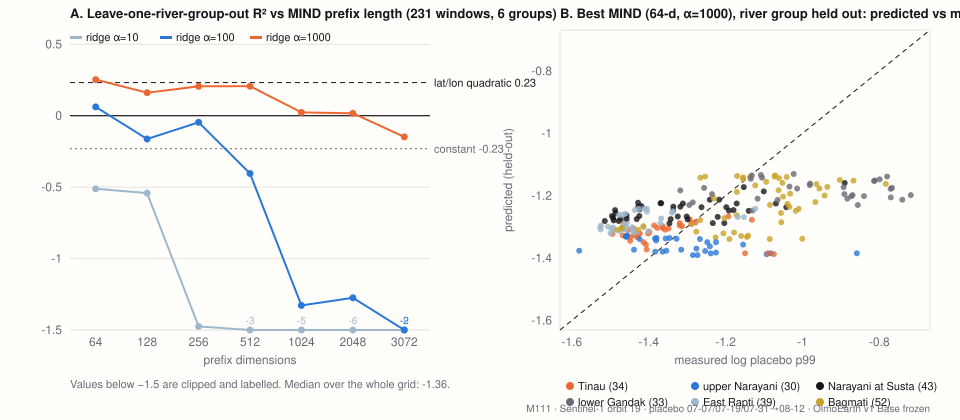

# M111 — Can a coordinate prior (MIND) give a per-window "ordinary change" baseline? (2026-10-19)

**Setting.** Frozen OlmoEarth v1 Base embeddings of Sentinel-1 RTC (γ⁰ dB), 2.56 km river windows, 3-vs-1 memory. Change score per 40 m token = cosine distance between the 3-pass pre-flood memory and the post-flood pass. A window is flagged when the share of tokens above a threshold exceeds 5%. Today the threshold is one pooled p99 of the placebo (no-flood) distances across all windows.

**Question.** Can the placebo p99 of a window be predicted from its coordinates alone, using MIND (Corley, Rao, Rolf, Klemmer, Shelhamer, Lehmann, Rußwurm, Mai, Jacobs, Kerner; arXiv 2609.25454; weights `taylor-geospatial/MIND`)? If so, a per-window baseline would separate mountain, plain and wet-season effects without extra imagery.

**Design.** Training set: 231 windows on Sentinel-1 orbit 19 with identical placebo dates (07-07, 07-19, 07-31 → 08-12), six river groups (Tinau 34, upper Narayani 30, Narayani at Susta 43, lower Gandak 33, East Rapti 39, Bagmati 52). Target: log placebo p99. Features: MIND 3072-d, prefixes 64…2048, standard ridge and Chunked-Penalty ridge (α·γ^chunk, following the paper's formulation, features standardised on the training split, intercept unpenalised). Hold-outs: random 5-fold and **leave-one-river-group-out**. Baselines: constant (current method), quadratic in lat/lon, coordinate IDW (k=10). Grid selection was done on the test metric, so the best MIND row is optimistic by construction.

| model | R² random | R² regional (river group out) | ρ regional |
|---|---:|---:|---:|
| constant (pooled threshold) | −0.02 | −0.23 | — |
| lat/lon quadratic ridge | 0.43 | **0.23** | 0.62 |
| coordinate IDW k=10 | 0.66 | 0.06 | 0.34 |
| MIND, median over 47 grid points | 0.61 | **−1.36** | — |
| MIND best (prefix 64, α=1000) | — | 0.25 | — |
| MIND full + Chunked Penalty (α=100, γ=100–1000) | 0.53 | 0.06 | 0.26 |

**Transfer** (best model fitted on all 231, Spearman ρ against measured placebo p99): same windows in 2024 (2-vs-1 contract) ρ 0.67; Budhi Gandaki, mountains, other placebo dates (37) ρ −0.36; Koshi on orbit 12 (51) ρ −0.56.

**Application.** Per-window threshold = pooled p99 × exp(prediction − mean), predictions taken from the regional hold-out. Truth = Copernicus GFM flood fraction ≥ 2% in the window (229 windows with GFM, 88 positive).

| τ | pooled threshold CSI (P / R) | per-window threshold CSI (P / R) |
|---|---|---|
| 5% | **0.598** (0.93 / 0.62) | 0.511 (0.92 / 0.53) |
| 3% | **0.616** (0.85 / 0.69) | 0.560 (0.82 / 0.64) |
| 2% | **0.644** (0.83 / 0.74) | 0.614 (0.83 / 0.70) |

**Reading.** Ordinary change has clear spatial structure: with labels nearby, the coordinate embedding explains about 60% of its variance. Across river groups the skill collapses; only the coarsest 64-d prefix under heavy regularisation survives, and it matches a quadratic in lat/lon. This is the paper's own finding reproduced on an operational problem: fine-scale components help only near labels, and our deployment case (six basins over ~400 km, new events in new basins) is the far case. A per-window baseline built from the prior lowers agreement with GFM, so the pooled threshold stays. The prior remains a candidate for interpolating unobserved stretches inside an already-measured river, with the regional-hold-out caveat stated on the map.

Code `code/mind_prior_m111.py`; outputs `research-private/artifacts/mind_prior_m111/report.json` (per-window measured p99, regional-hold-out prediction, scale, both fractions).

**Limitations, stated up front.** (1) Six river groups is a small regional design and the leave-one-group-out R² has high variance. Within each held-out group the best model's R² is negative everywhere (Narayani at Susta −0.03, Bagmati −0.23, Tinau −0.26, upper Narayani −0.34, lower Gandak −1.30, East Rapti −2.08), so the pooled +0.25 comes from getting the group-level offset roughly right, not from ranking windows inside a river. (2) The grid over prefix × α was selected on the test metric; the +0.25 row is an upper bound, not an estimate. (3) The target is one placebo contract (three July passes → 12 August) on one orbit; a different placebo season would move the target. (4) See the follow-up below for SatCLIP and GeoCLIP under the same folds. (5) Zero field labels; GFM is a model-based yardstick, not ground truth.

**What we would do next.** (a) Within-river interpolation: hold out every other window along one river and ask whether the prior fills the gaps better than linear interpolation along the centreline, which is the only use left open by the result above. (c) Repeat with the 2024 placebo as target to see whether the regional collapse is a property of the prior or of this one season.

## Follow-up (M112, same day): is it MIND, or the task?

Same 231 windows, same target, same folds, standardised ridge with α ∈ {0.1 … 10000}. Each encoder's "best" row is chosen on the test metric and is an upper bound.

| encoder | dim | best R² random | best α (regional) | best R² regional | median R² regional over α | best within-group R² | ρ 2024 | ρ Budhi Gandaki | ρ Koshi (orbit 12) |
|---|---:|---:|---:|---:|---:|---:|---:|---:|---:|
| lat/lon quadratic | 5 | 0.43 | — | 0.23 | — | — | — | — | — |
| SatCLIP L10 (ResNet50, 256-d) | 256 | 0.48 | 10000 | **0.26** | 0.05 | -0.00 | 0.64 | 0.08 | -0.57 |
| SatCLIP L40 (ResNet50, 256-d) | 256 | 0.57 | 10000 | **0.27** | -2.69 | 0.11 | 0.63 | 0.08 | -0.57 |
| GeoCLIP (512-d) | 512 | 0.63 | 1000 | **0.22** | -0.22 | 0.03 | 0.84 | 0.10 | -0.51 |
| MIND[:64] | 64 | 0.63 | 1000 | **0.25** | -0.23 | -0.03 | 0.67 | -0.36 | -0.56 |
| MIND[:256] | 256 | 0.63 | 1000 | **0.21** | -0.76 | 0.03 | 0.72 | -0.33 | -0.18 |
| MIND[:3072] | 3072 | 0.63 | 10000 | **0.22** | -5.68 | 0.04 | 0.74 | -0.16 | 0.10 |

All four location encoders, trained in different ways (contrastive with imagery, photo geolocation, INR distillation), reach the **same regional ceiling of 0.21–0.27, which is the lat/lon quadratic (0.23)**. Within a held-out river every encoder is at or below zero (best 0.11): what transfers across basins is a per-river offset, nothing finer. Transfer signs agree too: ρ 0.63–0.84 on the same windows a year later, about −0.5 on the Koshi from orbit 12 for every encoder. On random folds MIND and GeoCLIP (0.63) beat SatCLIP (0.48–0.57), consistent with fine components helping only near labels. So the "pooled threshold stays" conclusion does not depend on the choice of prior; with six basins over 400 km, no coordinate encoder carries a per-window baseline across rivers. Code `code/location_priors_m112.py`.
